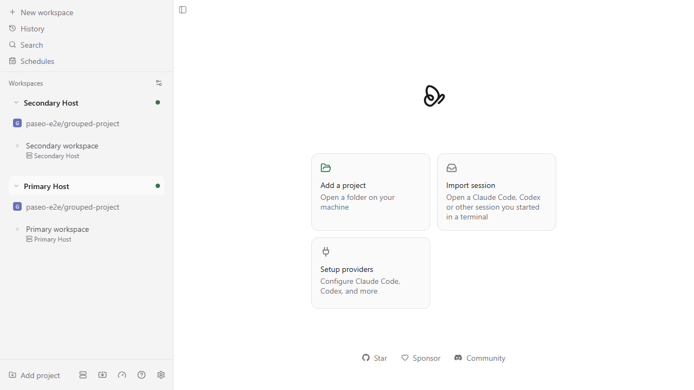
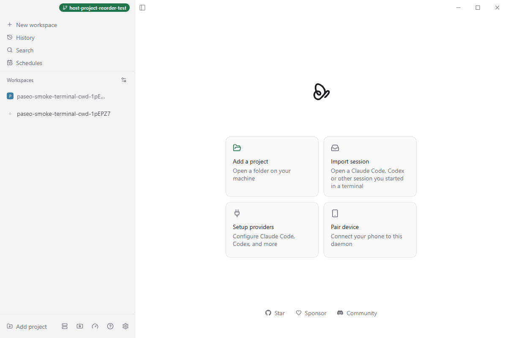

# Host → Project sidebar QA

Agent-run validation for the Host → Project grouping and scoped drag reordering feature.

The clean PR candidate is `9e66addd88c511e07636b684ed9d73dfafd79b10`, based on upstream `main` at `68e722ec2e02d933c78bf2b9c8ee40a642206b29`. It contains one feature commit and excludes the earlier plugin navigation PR (#5574).

Repository checks and unit tests ran against the clean PR candidate. Browser recordings and the packaged Windows smoke screenshot came from the development checkout at `4023af11b755f3d2ff6462b0dd02e639361ed8cf`, which has the same host grouping/reordering changes and also contains #5574. The test daemons and desktop profile were isolated from the main Paseo session.

## Browser behavior

Two real browser tests passed with video recording enabled:

- Drag expanded hosts, reload, drag collapsed hosts, and reload: the saved order survives each reload.
- Drag projects within one host and reload: the order persists. Attempt to drag a project to the other host: the project stays under its original host and the other host's list remains unchanged.



- [Host reordering recording](host-order.webm)
- [Project reordering and cross-host drop recording](project-order.webm)
- [Raw browser test output](browser-tests.txt)

```powershell
cd packages/app
$env:E2E_RECORD_VIDEO='1'
npm run test:e2e -- e2e/browser/sidebar-project-grouping.spec.ts --grep 'host-project grouping reorders' --timeout 120000
```

Observed result: `2 passed (2.3m)`.

## Clean PR candidate checks

- [Full workspace typecheck output](typecheck.txt): all workspace typecheck scripts passed.
- [Repository lint output](lint.txt): `Found 0 warnings and 0 errors.`
- [Changed-file formatting check](format.txt): all 26 matched files use the correct format, after running the repository formatter on those files.
- [Focused unit test output](unit-tests.txt): `6 passed` test files, `82 passed` tests.

```powershell
npm run typecheck
npm run lint
npm run format:files -- <the 26 files changed in the PR>
npm run format:check:files -- <the 26 files changed in the PR>
cd packages/app
npm run test -- src/components/sidebar/sidebar-projection.test.ts src/stores/sidebar-order-store.test.ts src/stores/sidebar-view-store.test.ts src/stores/sidebar-collapsed-sections-store/state.test.ts src/components/sidebar-workspace-list.test.tsx src/i18n/resources.test.ts
```

The focused tests cover host-scoped grouping and collapse state, persisted host order and view migration, project reorder validation, the existing parent list behavior, and locale resource consistency. `git diff --check` also passed.

## Windows package

The unpacked Windows application launched successfully with the `host-project-reorder-test` renderer label. The packaged smoke check passed cold daemon startup, CLI connectivity, the terminal hook, renderer/preload checks, and shutdown of the test-owned daemon.



[Smoke result](desktop-smoke.txt). This screenshot is startup evidence; drag interactions were exercised in Chromium as described above.

## Platform coverage

| Platform | Exercised |
| --- | --- |
| Web / Chromium on Windows | Two drag/reload tests with recordings and a screenshot |
| Windows desktop | Packaged startup/renderer/daemon/terminal smoke; desktop drag gestures not separately exercised |
| macOS desktop | Not exercised |
| Linux desktop | Not exercised |
| iOS | Not exercised |
| Android | Not exercised |

These artifacts are stored on a separate QA branch and are not included in the feature PR diff.
